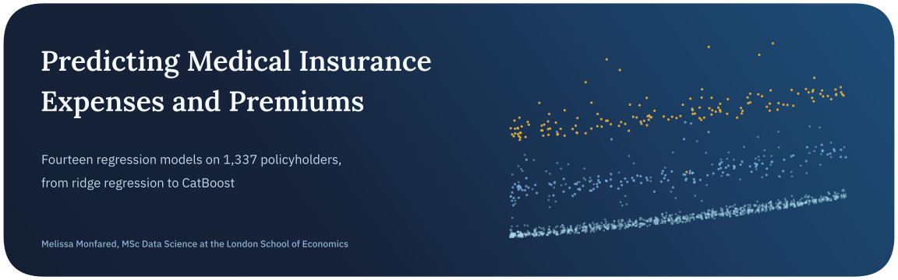
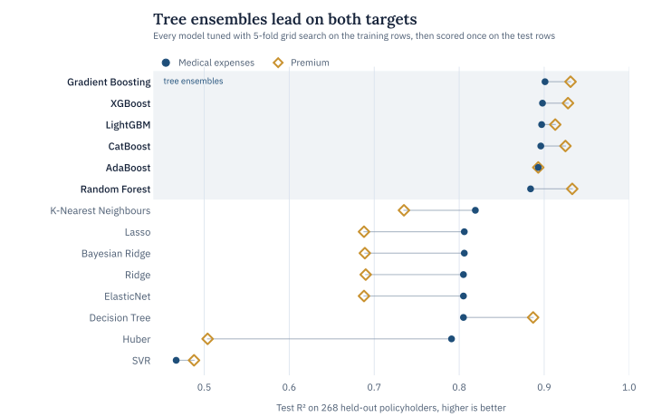
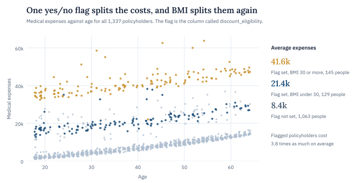
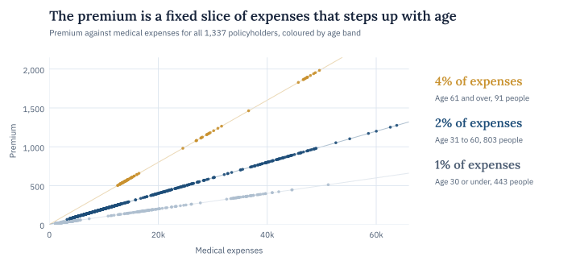
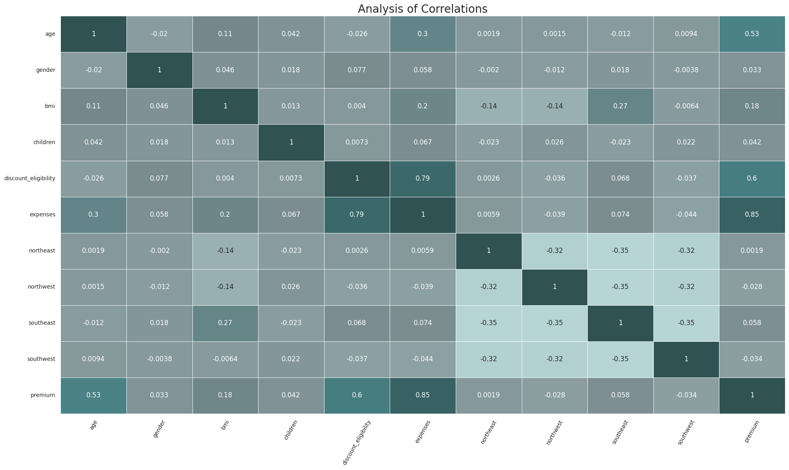

<p align="center">
  
</p>

<p align="center">
  <a href="https://www.kaggle.com/code/melissamonfared/prediction-of-medical-expenses-eda-regression"></a>
  
  
  
</p>

Medical bills vary enormously from one person to the next, and an insurer has to price that before any of it happens. This project asks how much of that variation fourteen regression models can explain from six basic facts about a policyholder, their age, sex, BMI, number of children, region and one yes/no flag.

Every model predicts two targets, medical expenses and the insurance premium. I tuned each one with 5-fold grid search on the training rows and then scored it once on 268 policyholders it had never seen.

> **In short.** Gradient-boosted trees explained about 90% of the variation in expenses and a random forest explained 93% of the variation in premiums, well ahead of every linear model. Most of the variation traces back to one flag and the way it interacts with BMI. Along the way the premium column turned out to be a fixed share of expenses that steps up with age.

## Key findings

| Finding | Evidence |
| :-- | :-- |
| Boosted trees predict expenses best | Gradient boosting reached a test R² of 0.901, and XGBoost had the smallest average error, about 2,390 on expenses that average 13,280. The regularised linear models stopped near 0.805 and 4,200 |
| A random forest predicts premiums best | Test R² of 0.933 and an average error of 44 on premiums that average 263, against about 0.69 and 121 for the linear models |
| One yes/no flag drives most of the cost | The flag the data calls discount_eligibility correlates 0.79 with expenses. Age comes next at 0.30 and BMI at 0.20, and nothing else passes 0.08 |
| BMI matters mainly when the flag is set | Flagged policyholders with a BMI of 30 or more average about 41,600 in expenses, nearly double the 21,400 for flagged people below 30 |
| The premium is exactly a share of expenses | It is 1% of expenses up to age 30, and the rate doubles at 31 and again at 61. That is why premium tracks age (0.53) far more closely than expenses do (0.30) |
| Single trees and nearest neighbours memorise | K-nearest neighbours with distance weighting scored a perfect 1.000 on the training rows and 0.819 on test, and a lone decision tree fell from 0.984 to 0.805 |

<picture>
  <source media="(prefers-color-scheme: dark)" srcset="assets/results-dark.svg">
  
</picture>

## Conclusion

Most of the predictable variation in these medical expenses comes from one flag and how it combines with BMI. Costs jump when the flag is set and jump a second time when BMI passes 30. Age adds a steady climb underneath. Tree ensembles can find those breaks on their own, which fits with all six of them landing between 0.88 and 0.90 R² on expenses while the best linear model stopped at 0.81.

The linear models are missing a shape rather than a signal. They see the same six facts, but a straight line can’t double the cost only for flagged people with a high BMI, and an interaction term between the flag and BMI would give them exactly that.

The premium needs a different reading altogether. Because it is a fixed share of expenses set by age band, modelling it as a separate outcome throws that structure away. Predicting expenses and then applying the age-band rate gives a premium that agrees with the expense forecast by construction.

## The data

The data is the widely used medical cost dataset from Kaggle, in a version that renames some columns and adds a premium. It covers 1,338 policyholders across four regions. The yes/no flag it calls discount_eligibility lines up exactly with the smoker column of the original dataset, which explains why it carries so much weight.

I dropped one duplicated row, leaving 1,337. A three-standard-deviation check flagged 29 individual values but no row that was extreme on more than one feature, so nothing else was removed. Categorical columns are one-hot encoded, and an 80/20 split with a fixed seed gives 1,069 training rows and 268 test rows, with features standardised using training statistics only.

<picture>
  <source media="(prefers-color-scheme: dark)" srcset="assets/drivers-dark.svg">
  
</picture>

The premium column follows a simple rule, and it shows up as soon as you plot it against expenses.

<picture>
  <source media="(prefers-color-scheme: dark)" srcset="assets/premium-rule-dark.svg">
  
</picture>

<details>
<summary><b>Correlations between all encoded features</b></summary>
<br>


The flag’s correlation with expenses (0.79) is more than twice that of age (0.30), and the four region columns barely register.

</details>

## The models

| Family | Models |
| :-- | :-- |
| Linear | Ridge, Lasso, ElasticNet, Bayesian Ridge, Huber |
| Single tree and neighbours | Decision Tree, K-Nearest Neighbours |
| Kernel | Support Vector Regressor |
| Tree ensembles | Random Forest, Gradient Boosting, AdaBoost, XGBoost, LightGBM, CatBoost |

Each model went through GridSearchCV with 5-fold cross-validation on the training rows, optimising mean squared error. It was then scored once on the test rows with MAE, MSE, R² and adjusted R².

<details>
<summary><b>Full test results for all fourteen models</b></summary>
<br>

| Model | Expenses R² | Expenses MAE | Premium R² | Premium MAE |
| :-- | --: | --: | --: | --: |
| Gradient Boosting | 0.901 | 2,494 | 0.931 | 51.1 |
| XGBoost | 0.898 | 2,393 | 0.928 | 44.2 |
| LightGBM | 0.897 | 2,462 | 0.913 | 57.2 |
| CatBoost | 0.896 | 2,565 | 0.925 | 49.3 |
| AdaBoost | 0.893 | 2,911 | 0.893 | 81.3 |
| Random Forest | 0.884 | 2,564 | 0.933 | 44.0 |
| K-Nearest Neighbours | 0.819 | 3,513 | 0.735 | 103.8 |
| Lasso | 0.806 | 4,179 | 0.688 | 120.9 |
| Bayesian Ridge | 0.806 | 4,185 | 0.689 | 120.8 |
| Ridge | 0.805 | 4,203 | 0.690 | 120.9 |
| ElasticNet | 0.805 | 4,204 | 0.688 | 120.7 |
| Decision Tree | 0.805 | 2,758 | 0.887 | 53.3 |
| Huber | 0.791 | 3,355 | 0.504 | 111.5 |
| Support Vector Regressor | 0.467 | 4,871 | 0.488 | 112.4 |

</details>

## Limitations and next steps

Everything rests on one random split, so 268 test rows decide the ranking, and the five boosting models sit within 0.01 R² of each other on expenses. Those test rows also happen to be more spread out than the training rows, with a standard deviation of about 13,600 against 11,700. That is why gradient boosting scores a higher R² on test than on training even though its test error is slightly larger. Random forest and AdaBoost run without a fixed seed, so their numbers move a little between runs.

Next I’d add flag-by-BMI and flag-by-age interactions to the linear models, model the logarithm of expenses, swap the single split for repeated cross-validation and explain the boosted models with SHAP.

## Running it

The quickest way is to [open the notebook on Kaggle](https://www.kaggle.com/code/melissamonfared/prediction-of-medical-expenses-eda-regression), where the dataset is already attached. To run it locally, install the packages below and download medical_insurance.csv from the dataset attached to the Kaggle notebook. Then change the file path in the second code cell to point at your copy.

```bash
pip install numpy pandas matplotlib seaborn scikit-learn xgboost lightgbm catboost ydata-profiling
jupyter notebook prediction-of-medical-expenses-eda-regression.ipynb
```

## Repository

```text
.
├── prediction-of-medical-expenses-eda-regression.ipynb   EDA, preprocessing and all fourteen models
├── assets/                                               figures used in this README
└── README.md
```

## About

Made by Melissa Monfared, MSc Data Science at the London School of Economics. More projects live on [my website](https://melissamonfared.github.io). I also post notebooks on [Kaggle](https://kaggle.com/melissamonfared) and I’m on [LinkedIn](https://linkedin.com/in/melissamonfared).

The data comes from Kaggle and is a version of the medical cost dataset that first appeared in Brett Lantz’s *Machine Learning with R*.
